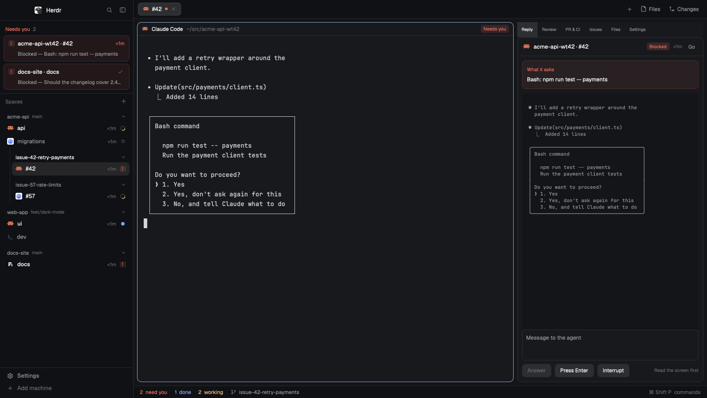

# Triage for Herdr

A [Herdr](https://herdr.dev) layout for running many coding agents at once. The sidebar is an inbox: the agents that need you sit in a band at the top, longest waiting first; below it, your spaces and their tabs in a stable order. A side panel answers an agent without opening it, and shows the repo's pull requests, CI and issues. From an issue, one click starts an agent on it in its own worktree.



## Features

- **Needs you.** Every blocked or failed agent, local or on another machine, sub-agents included, with how long it has waited and what it asked. `⌘⇧J` jumps to the next one. Mark one as seen to set it aside until its state changes again.
- **Spaces and tabs in a stable order.** Agents don't move around as they change state. Pin a tab to the top, snooze it for an hour or until tomorrow (a block wakes it), or archive it. Sub-agents hang under their parent with their own icon.
- **Worktrees under their repo.** A space opened in a worktree nests under its repo's main checkout. Folded, the checkout shows "+N worktrees" and the most urgent state among them.
- **Reply.** The last 40 lines of the selected agent's screen, a box to answer it, Press Enter for approvals and Interrupt.
- **PR & CI.** The current branch's pull request with its checks, failures first; then the repo's open pull requests, or yours.
- **Issues.** The repo's open issues, or yours, two lines each with labels and sub-issue progress. The issue view renders Markdown, opens `#123` links in place, and lets you comment, assign yourself, edit labels, close and reopen.
- **Start agent.** From an issue: pick the agent, its permission mode, a checkout or a new worktree, and a first message from a template. The worktree goes where Herdr's own worktree dialog puts them, `~/.herdr/worktrees/<repo>/<branch>`, on the space's machine.
- **Settings.** Message templates with `{number}`, `{title}`, `{repo}`, `{url}`, `{slug}` and `{branch}`; permission modes per agent; the branch name pattern. Saved as you type.
- **Status bar.** Counters for need you, done and working (the first two jump to the next one), and the focused folder's branch with ahead/behind and changed files.
- **Rail.** Fold the sidebar to a column of icons and states.

GitHub data comes from the [GitHub CLI](https://cli.github.com) and is cached for five minutes per folder, so it doesn't eat your rate limit.

## Install

You need Herdr and `gh`, logged in with `gh auth login`.

Clone this repository and link the mods into Herdr's home, so a `git pull` updates them:

```sh
git clone https://github.com/sgomez/herdr-triage.git ~/src/herdr-triage
cd ~/src/herdr-triage
for m in mods/*; do ln -s "$PWD/$m" ~/.config/herdr-app/mods/; done
cp layouts/triage.json layouts/triage.svg ~/.config/herdr-app/layouts/
herdr-app do layout.switch --name triage
```

Then merge `keys.json` into `~/.config/herdr-app/keys.json`: it adds `⌘⇧J` (next blocked), `⌘⇧U` (next done) and `⌘⇧R` (side panel) to this layout only. `ctrl-shift-l` switches back to any other layout.

Or ask an agent to add it from herdr.dev: it follows [RECIPE.md](RECIPE.md).

### Defaults for everyone using your layout

The launcher reads its settings in this order: what the person saved in Settings, then `props.defaults` on the `triage-launch` block in the layout, then its own. To ship your team's templates and modes, add them to the Settings block in `layouts/triage.json`:

```json
{ "id": "settings", "type": "block", "title": "Settings",
  "content": { "mod": "triage-launch", "props": { "settings": true, "defaults": {
    "templates": [{ "name": "Implement", "text": "/implement-issue {number}" }],
    "modes": { "claude": [{ "name": "Auto", "args": ["--permission-mode", "auto"] }] },
    "branch": "issue-{number}-{slug}" } } } }
```

## What it runs

Before you add it, know that these mods run programs:

- `gh` for pull requests, checks and issues, and for the actions you take on them (comment, assign, label, close).
- `git` to read the branch and status, find each space's repo, and create worktrees (`git worktree add`).
- `hc` (Herdr's CLI) to read agents' screens, send them text and keys, and list machines.
- `open` or `xdg-open` for links that leave the app.

Only `gh` reaches the network.

## On another machine

Herdr checks which agents a remote machine has with a plain `sh`, which reads none of your shell's startup files. If an agent installed in `~/.local/bin` doesn't show up in the launcher there, add that folder to the `PATH` in a file every shell reads (for zsh, `~/.zshenv`) and restart `herdr-core` on that machine.

## Development

```sh
npm test
```

Checks the JSON, the syntax of every mod, that each mod and icon the layout uses exists, and runs the unit tests of the pure helpers in each mod's `lib.js`. The views themselves need Herdr: `herdr-app check mods/<name>` in a linked install.

## License

[EUPL-1.2](LICENSE) © 2026 Sergio Gómez
