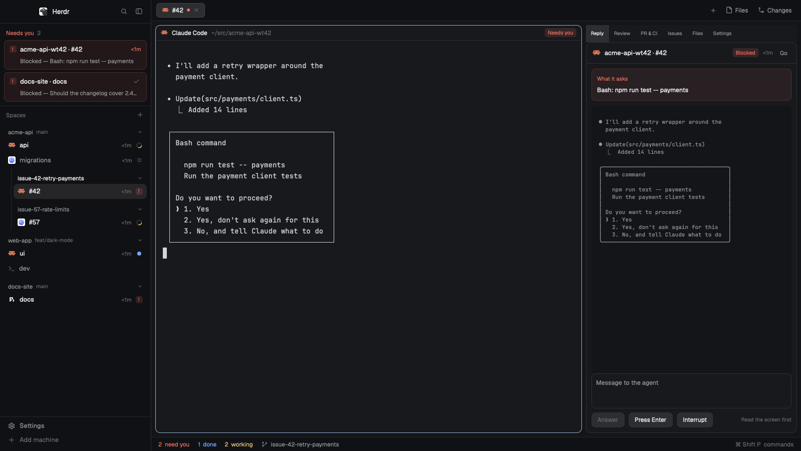

# Triage

A layout for running many agents at once, built around one question: who needs me now? The left sidebar is an inbox, with blocked agents in a band on top and spaces with their tabs below in a stable order. A right panel lets you answer an agent without leaving the one you're in, and brings the repo's pull requests, CI and issues next to the terminals, with a launcher that starts an agent on an issue in its own worktree.

## What you see

Left to right:

1. **Sidebar** (300 px, `chrome` background, not resizable by drag; folds to a rail).
   - **Brand** (46 px): shipped `workspace-chrome`, with search and the fold button. It's the window drag area.
   - **Inbox** (the rest): the `triage` mod.
     - "Needs you" band, at most 260 px, scrolling. Each row is tinted with `blocked` and shows the state mark, "space · tab", the machine if remote, and how long it has waited. A second line says "Blocked" or "Error", the sub-agent's name if it is one, and the first line of its message. Empty: "Nobody. All moving." A folded "Seen N" group holds the ones marked as seen.
     - "Spaces" row with a `+`.
     - Optional "Pinned" group. Then each space: a header with name, branch (small, dim) and machine, a chevron, and its tabs as 30 px rows (program icon, title, time in state, mark). An agent's sub-agents go below it, indented, with `└` and their own icon. Worktree spaces sit indented under their repo's main checkout, behind a 1 px left border, named by branch.
     - Folded "Snoozed" and "Archived" groups at the end.
   - **Footer** (69 px): shipped `workspace-chrome` with `props.footer`: Settings and Add machine.
2. **Work column.**
   - **Tabs** (42 px): shipped `tabs`.
   - **Main**: the terminals.
   - **Side panel** (420 px, hidden by default, toggled with `⌘⇧R`): a stack of Reply, Review (shipped `changes`), History, PR & CI, Issues, Files (shipped `files`) and Settings.
   - **Status bar** (28 px): `triage-status`.

State marks, shape as well as color: working is a spinning ring in `working`; blocked is a rounded square with `!` (`×` for error) on `blocked` at 15% alpha; done is a filled dot in `done`; idle is a hollow ring.

## How it behaves

- **Order.** The band sorts by wait time, longest first. Spaces and tabs keep Herdr's order; nothing jumps when a state changes. A folded space shows its most urgent state on its header; a folded checkout with worktrees adds "+N worktrees" and counts their tabs too.
- **Clicks.** Clicking a band row or an agent's tab focuses that agent and opens Reply on it. Clicking a tab without an agent selects it. Clicking a space header folds it. Right-click on a space or tab opens the shipped `menu` popup (`{tab: "space"|"tab", target}`).
- **Hover.**
  - A tab row swaps its time for Pin, Snooze (a popup: 1 hour, this evening at 18:00 before 17:00, tomorrow at 9:00) and Archive (`tab.settle`).
  - A band row shows ✓ "Mark as seen" (× to undo). Seen is stored as the time the state began, so it ends when the state changes.
  - A space header shows `+`. It selects the space, waits until it is active, then opens shipped `new-menu`. Waiting matters: `new-menu` looks up installed agents on the active space's machine as it opens.
- **The Spaces `+`.** With connected remote machines, a popup offers "This computer" or each machine; otherwise it runs `space.new`.
- **Snooze** wakes on its time, or when the tab blocks.
- **Keys.** `⌘⇧J` focuses the next unseen blocked agent; `⌘⇧U` the next done one; `⌘⇧R` toggles the panel. All three are in `keys.json`, scoped to `layout:triage`.
- **Rail.** Below 160 px wide the inbox draws a column: blocked agents first, then each tab as icon plus mark, with separators between spaces and a tooltip with the name. `»` at the bottom unfolds it to the width it had. The fold button and the rail agree with `workspace-chrome` because both go by the sidebar's width.
- **Reply** follows the target set by a click (`shared("triage.target")`), else the focused agent. It shows state, the last 40 lines of its screen (`hc read`), and a textarea. Send uses `hc send` (`--force` when blocked). "Press Enter" appears only when blocked. Interrupt runs `hc interrupt`. It re-reads the state just before acting, so it never sends to an agent that moved on.
- **History** follows the focused folder.
  - Header: the branch, Branch or All (`--branches --remotes --tags HEAD`, remembered), Refresh, and a filter on message, author, hash and branch (the graph hides while filtering).
  - `git log --date-order`, 100 at a time with "Load more", re-read every 10 s while shown. A band on top counts uncommitted changes and opens Review.
  - Lanes are 2 px divs; joins are a quarter-circle corner (a div with two borders and one rounded corner), so they scale with the zoom. A line keeps its color from start to end, from a fixed palette for dark and light; HEAD is a ring.
  - Each row: author initials in a color from their name, up to two branch or tag chips, `#N` for merged pull requests, the conventional commit type (`!` if breaking) and scope, the subject and its age.
  - A click expands the commit: hash, author, date, body and up to 12 files with +/− (`git show --numstat`). A file opens its diff, and "Open diff" the whole commit, with `git show` in a terminal to the right.
- **PR & CI** follow the focused terminal's folder.
  - The current branch's PR shows its review decision and checks, bucketed fail, pending, pass, skip, failures first, each linking to its run.
  - Below it, Open or Mine PRs, 30 at a time, with "Load more".
- **Issues** also follow the focused folder.
  - Open or Mine, two lines each with labels and sub-issue progress. Issue numbers seen on the focused terminal's screen are listed on top.
  - The detail view renders body and the last five comments as Markdown. `#123` and links to this repo's issues open in place, with Back (`← #N`), and pull requests open in the browser. You can comment, assign yourself, remove labels, close and reopen.
  - "Hand to agent" drafts a message in Reply. "Start agent" opens the launcher.
  - Lists are cached per folder and filter for five minutes (`localStorage`); Refresh forces a fetch.
- **Launcher** (`triage-launch` as a dialog, props `{space, folder, issue}`):
  - Chips for agent (`knownAgents` on the space's machine), mode, Checkout or Worktree, and template; a branch field; a task textarea.
  - Checkout runs `tab.new {space, folder, argv, task, name: "#N"}`.
  - Worktree finds the repo with `git rev-parse --git-common-dir` and `$HOME` on that machine, runs `git worktree add` (with `-b` for a new branch) into `~/.herdr/worktrees/<repo>/<branch>`, then `space.new {folder, machine, argv, task}`.
  - Errors stay in the dialog. The last agent, mode per agent and template are remembered.
- **Settings** (`triage-launch` with `props.settings`):
  - Templates: a list where ★ marks the default (first) and × deletes, plus one editor with name, message, variable chips and a live preview on a sample issue.
  - Modes: a tab per installed agent, each mode with a name and arguments as text, and a "Runs:" line.
  - The branch pattern with an example.
  - Every change saves at once to `shared("triage.launch")`. Each section has "Reset to defaults". A folded "Advanced: JSON" allows copy and paste.
  - Config precedence: shared, then the layout's `props.defaults`, then built-in.
- **Status bar.** "N need you" and "N done" (click to jump), "N working", then the focused folder's branch, `↑ahead`, `↓behind` and `±changed` (click opens Review). Refreshes every 10 s.

## Built from

- **Layout** `layouts/triage.json`:
  - `root` row: `sidebar` column (`brand`, `inbox`, `sidebar-footer`; `min` 44) and `work` column.
  - `work` holds `tabs`, a `work-body` row (`main`, then `panel` with the `panel-body` stack) and `status`.
  - `titlebar: "none"`, macOS traffic lights at `[12, 16]`, preview `layouts/triage.svg`.
- **Mods** here: `triage` (inbox; its popups are copies of itself with `props.snooze` or `props.newSpace`), `triage-reply`, `triage-history`, `triage-pr`, `triage-issues`, `triage-launch`, `triage-status`. Each has `"place": "none"`, and pure helpers in `lib.js`.
- **Shipped mods**: `workspace-chrome` (brand, footer, and its SVG icons, used by path), `tabs`, `changes`, `files`, `menu`, `new-menu`.
- **herdr**:
  - state: `agents`, `terminals`, `spaces`, `focused`, `panes`, `knownAgents`, `layout`, `shared`/`setShared`, `setAgentOrder`, `nextCommand`;
  - overlays: `openOverlay`/`closeOverlay`;
  - commands: `terminal.open`, `layout.select`, `layout.show`, `layout.toggle`, `layout.resize`, `space.select`, `space.new`, `tab.new`, `tab.select`, `tab.settle`, `tab.unsettle`, `terminal.peek`.
- **Programs**: `gh`, `git`, `sh`, `hc`, `open`/`xdg-open`.
- **Shared keys**: `triage.pins`, `triage.snoozed`, `triage.seen`, `triage.target`, `triage.draft`, `triage.launch`, `triage.launch.last`, and `workspace.panels`, to which the inbox adds `reply`, `history`, `pr`, `issues` and `settings` so the shipped `tabs` restores them.

## Watch out

- `InputState`/`TextareaState` must be made in `init` or a handler, never in `render`.
- `set_value` doesn't fire `"change"`: save explicitly after it, and guard `"change"` handlers while loading an item into a shared editor.
- Read props with `props()`; `init`'s first argument isn't them.
- Write `mod.json` before `main.js`, or Herdr auto-places the mod. `.bg(null)` throws; use `.when()`.
- `run()` returns before the command applies. Wait for the result in shared state before opening something that reads it.
- The shipped `tabs` restores only the panels listed in `shared("workspace.panels")`; without that, the panel comes back closed.
- `gh` has no cursor pagination: "Load more" asks again with a larger `--limit`.
- Sub-agents carry no tab labels; place them by their nearest labelled ancestor.
- On remote machines `knownAgents` uses a bare `sh`, so agents installed only on a login `PATH` appear as not installed.
- The sidebar's `min` must be below the rail width (44), or the fold button does nothing.
- Not done:
  - the launcher doesn't init submodules, and opens only from an issue;
  - variable chips append at the end, not at the cursor;
  - `@user` isn't linked.

## Done when

- `herdr-app check` passes for every `mods/triage*` and `layout.switch {name: "triage"}` shows no errors in `herdr-app status`.
- A blocked agent shows in the band with its wait time; `⌘⇧J` focuses it; "Mark as seen" moves it to "Seen" until it blocks again.
- Reply shows the agent's screen and Send reaches it.
- In a GitHub repo, Issues lists open issues, the detail renders Markdown, and `#N` in a body opens that issue with Back.
- Start agent with Worktree creates `~/.herdr/worktrees/<repo>/<branch>` and a new space with the agent running the template, nested under the repo's checkout.
- A template edited in Settings survives a restart.
- In a git repo, History draws its commits with lanes; a click shows the files, and a file opens its diff to the right.
- Folding the sidebar draws the rail; `»` restores it.
- `npm test` passes.
